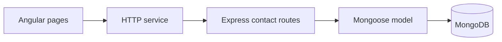

# iPhone Contacts App

A web-based contact directory built in 2022. Create a contact, find it in the list, update its details or remove it. The Angular client, Express API and MongoDB database can run together with Docker Compose.

## Architecture



The client calls the API on localhost port 3000. The API uses the Compose service name to connect to MongoDB. Keeping HTTP access in the Angular service keeps the contact pages focused on form and list behavior. For a deployment on another host, the client endpoint and database configuration need to change.

## Run locally

Clone this repository and start the stack from the directory containing the Compose file.

```sh
git clone https://github.com/rezanicgil/IphoneContacts-App.git
cd IphoneContacts-App/IphoneContactsApp
docker compose up --build
```

Open http://localhost:4200 for the interface. The compose configuration binds the database data directory to /data/db on the Docker host. Use synthetic contacts when trying the demo.

## Verify the flow

Create a sample contact, open its details, edit it, refresh the list and confirm the new value. Delete that same sample contact and confirm it disappears. The API exposes `GET /contacts-list` and `GET /contact-details/:_id` for readback.

The Angular project contains component and service specs. Run `npm test` in `IphoneContactsApp/angularapp` with the matching Angular dependencies and a browser installed. The Express package has a placeholder test script. The historical toolchain used Node 16 and Angular 14. End-to-end execution with current container images has not been verified.